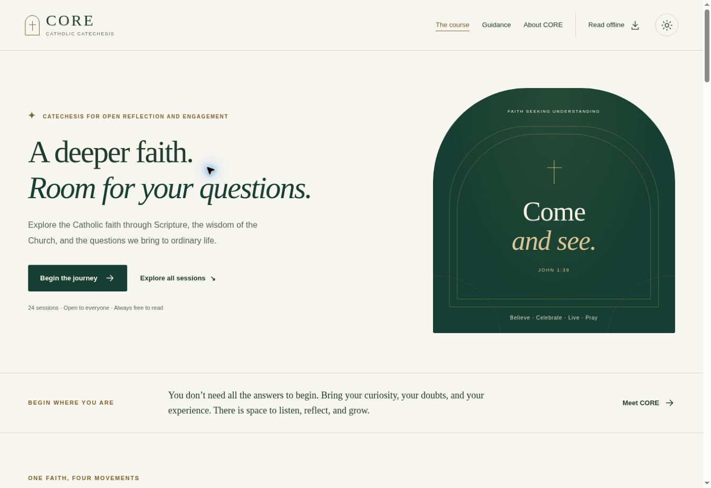

# CORE

**Catechesis for Open Reflection and Engagement**

A free, open Catholic catechesis, built as a calm, accessible reading experience
for desktop and mobile. Every session is a real HTML page compiled from its own
Markdown source. No client-side framework, accounts, analytics, external fonts
or third-party browser scripts.



Implementation and verification notes are in [docs/verification.md](docs/verification.md).

## What is included

- **24 sessions** across foundations, communion and prayer, sacramental life,
  and discipleship and hope. All seven sacraments have dedicated coverage.
- **72 answered FAQs**, Scripture and Catechism references, practical activities,
  weekly steps and 15 attributed quotations from Fathers, saints and popes.
- **Seven guidance pages** covering purpose, facilitation, accessibility, sources,
  open publishing, production and the independent critic's review.
- **24 two-page learner PDFs**, each paired with an equivalent printable HTML
  sheet. All are generated from the corresponding session source.
- Full-text session search, course-part filters, previous/next navigation,
  device-local completion tracking, a resume link and progress export.
- Light/dark themes, a larger-text option, skip links, semantic headings,
  visible focus, reduced-motion and forced-colour support, and mobile navigation.
- A **progressive web app** with install metadata and icons, a versioned service
  worker, complete-course offline caching and an explicit update prompt.
- Automated checks, a GitHub Actions build artifact, and an optional manual
  GitHub Pages deployment workflow.

## Run locally

Requires **Node.js 22 or later** and npm. No Python, browser download, API key,
database or external service is needed to build the site or PDFs.

```sh
npm ci --ignore-scripts
npm run build
npm run dev
```

Open the address printed by the dev server, normally `http://localhost:4173/`.
The dev server serves `dist/`; it is not a file watcher. After editing content,
CSS or JavaScript, run `npm run build` and refresh. `PORT` and `HOST` configure
the preview server when needed.

```sh
npm run check          # build the complete site, then run the checks
npm test               # check an existing build
```

The default build uses root-relative paths. To reproduce a project-site build
under `/core/`, set the same base for the build, checks and local server:

```sh
BASE_PATH=/core/ SITE_URL=https://mbaldwinsmith.github.io/core/ npm run check
BASE_PATH=/core/ npm run dev
```

`BASE_PATH` must begin and end with `/`, for example `/`, `/core/`, or
`/courses/core/`. On PowerShell, set environment variables before the command:

```powershell
$env:BASE_PATH = "/core/"
$env:SITE_URL = "https://mbaldwinsmith.github.io/core/"
npm run check
npm run dev
```

The default `SITE_URL` targets the intended GitHub Pages address; it is used in
canonical URLs, the sitemap and printed sheet references. It is not evidence
that the site has been published. Set it to your actual public URL when hosting
elsewhere, including its base path and trailing slash.

## Editing sessions

Edit files in **`content/sessions/`**. Each has JSON front matter between `---`
delimiters, followed by ordinary Markdown:

```md
---
{
  "number": 1,
  "title": "Encountering Jesus and asking questions",
  "slug": "01-encountering-jesus-and-asking-questions",
  "part": 1,
  "minutes": 90,
  "question": "What are we looking for?",
  "quotes": ["Q1", "Q2"]
}
---

# Encountering Jesus and asking questions

## Begin with a question

What are we looking for? Participants can describe the Christian proclamation.

## Explore the faith

1. The first essential teaching.

2. The second essential teaching.

3. The third essential teaching.
```

The normal session structure continues with `Read and discover`,
`Questions worth asking` (three level-three question headings and answers),
`Reflect and practise`, and `Carry it into the week`. Session 24 uses
`Continue the journey` for its final step. Additional sections and Markdown
tables are supported on full session pages.

Preserve these section names: the learner HTML and PDF generators use them to
select the core teaching, FAQs and practical steps. The PDF deliberately omits
specialist writer/facilitator supplements, which remain on the full session
page. If an edit no longer fits the two-page sheet, the build fails rather than
silently clipping it. Shorten the learner text thoughtfully or revise and
visually check the PDF layout in `scripts/pdf.mjs`.

Keep published slugs stable so existing links and printed references continue
to work. The current build validates a 24-session, consecutively numbered course;
adding or removing sessions requires updating that validation and the part data.

### Guidance and quotations

- Edit guidance in `content/guidance/`.
- Edit the quotation records in `content/quotes.json` **and** the human-readable
  register in `content/guidance/sources.md` together. Preserve wording, attribution,
  context and third-party rights notices.
- `content/framework.md` preserves the reviewed planning document as provenance.
  It is not the live source for edited session pages.
- `scripts/import-framework.mjs` performed the initial migration. Do **not** rerun
  it during normal editing. It regenerates guidance and quotation data; `--force`
  also overwrites session files. Commit or back up changes before using it.

Raw HTML in Markdown is disabled. The compiler adds heading IDs, a table-of-contents,
scrollable reference tables and source anchors. Core content and navigation are
rendered at build time, so they remain available with JavaScript disabled.

## Project layout

```text
content/
  sessions/          24 independently editable Markdown sessions
  guidance/          7 Markdown guidance pages
  quotes.json        Quotation wording, attribution and source URLs
  framework.md       Reviewed framework retained for provenance
public/assets/       Vanilla browser code, CSS and original install icons
scripts/
  build.mjs          Static pages, downloads, manifest, sitemap and cache version
  content.mjs        Source loading and learner-content extraction
  pdf.mjs            Two-page PDF layout
  service-worker.template.js
  serve.mjs          Small local static preview server
tests/               Node's built-in test runner
dist/                Generated deployment output; intentionally untracked
```

The public output includes `/sessions/<slug>/`, `/guidance/<slug>/`,
`/learner-sheets/<slug>.pdf`, `/learner-sheets/<slug>/`, and Markdown downloads.
`dist/` can be copied to any ordinary static host. There is no server application
or routing fallback requirement; directory URLs resolve to `index.html` files.

## Why two build libraries

**markdown-it** provides proper CommonMark parsing. **pdf-lib** handles PDF
serialization and standard-font metrics. Both run only at build time. Replacing
either would duplicate substantial specialist code. The browser uses only the
site's own HTML, CSS and vanilla JavaScript. Versions and transitive dependencies
are locked in `package-lock.json`.

The optional `scripts/create-icons.py` maintainer tool uses Pillow to regenerate
the original PNG artwork. The generated icons are committed; Python and Pillow
are not build dependencies. Colour and typography tokens live at the top of
`public/assets/site.css`.

## PWA and offline behaviour

On a successful first visit, the service worker downloads the entire local
course: sessions, guidance, learner HTML and PDFs, source downloads and assets.
The footer changes to **“Course ready offline”** only after installation is
complete. A failed download rejects installation and discards the partial cache.
External source sites still require an internet connection.

Service workers require **HTTPS**, except on trusted development origins such
as `localhost`. An HTTP remote preview hostname may render the site correctly
while disabling installation and offline caching. CORE reports that state rather
than claiming the course is available offline.

Each build hashes its output into a new cache version. An installed edition is
served consistently from its cache. A later edition downloads in the background
and waits for the reader to press **Update CORE**; completion data is kept.
Activation removes only older CORE caches for the same installation scope.
Root and subdirectory deployments have distinct cache prefixes.

Installation support varies. Chromium browsers may offer an install prompt;
iOS/iPadOS readers use Safari's Share → Add to Home Screen. Installation is
optional. Browser storage can be evicted or cleared, especially in private mode;
download PDFs independently if permanent copies matter.

## Privacy and accessibility

There are no accounts or tracking integrations. Local storage contains only
completion numbers, the last session number, colour theme and text size. Export
and reset controls are on About CORE. The export is a personal JSON record;
automatic import and cross-device synchronisation are not implemented. Ordinary
hosting logs remain the host's responsibility.

The HTML aims at WCAG 2.2 AA practices: labelled controls, keyboard access,
semantic landmarks, visible focus, responsive layouts, reduced motion, colour
themes and selectable content. No formal conformance certification is claimed.
Learner PDFs contain selectable text, titles and language metadata, but are **not
fully tagged PDF/UA documents**. The equivalent learner HTML is the preferred
screen-reader alternative. Test with real readers and assistive technology before
claiming comprehensive accessibility.

## Verification

`npm run check` verifies the 24 source files and generated routes, preservation
of the 72 original FAQs, seven guides, quotation references, local links and
fragments, unique IDs, reading landmarks, manifest scope/icons, and the title,
language and page count of every learner PDF. Service-worker simulations exercise
offline directory requests, complete-course precaching, failure cleanup and scope
isolation. These are meaningful build checks, not a substitute for real browsers.

Before releasing, also check:

- Desktop and 320/390px mobile layouts, keyboard navigation and zoom.
- Search, filters, resume links, completion persistence, theme and reading size.
- Reduced motion, high contrast and screen-reader navigation.
- Every changed learner PDF at readable scale, including the second page.
- A first HTTPS/localhost visit, offline navigation to an unvisited session and
  PDF, then a new build and the update prompt.

CI runs the full checks at `/` and `/core/` and uploads a static-site artifact.
The initial implementation was also visually checked in the provided browser
preview and all 48 learner-PDF pages were checked for text bounds and layout.
See the pull request for the precise browser-verification limits.

## Deploy

### GitHub Pages

1. Merge the implementation into `main`.
2. In repository **Settings → Pages**, choose **GitHub Actions** as the source.
3. Run the **Publish GitHub Pages** workflow from Actions on `main`.
4. Use the deployment URL returned by that workflow.

Publication is manual: this repository does not silently publish every push.
The workflow builds for `/core/` and the intended address
`https://mbaldwinsmith.github.io/core/`. For another repository name, owner or
custom domain, edit `BASE_PATH` and `SITE_URL` in the workflow. Do not claim the
intended address is live until deployment succeeds.

### Other static hosts

Run `npm ci --ignore-scripts`, then `npm run check` with the correct environment
variables, and publish **`dist/`**. Serve HTML, CSS, JavaScript, PNG, SVG, PDF and
the web manifest with correct MIME types. Serve `sw.js` with revalidation/no-cache
rather than an immutable long cache. HTTPS is required for the PWA. No root-scope
`Service-Worker-Allowed` override is needed or recommended.

## Editorial status and licences

This first edition faithfully presents the reviewed **planning framework** and
its session briefs. It is not a finished set of facilitator scripts and does not
constitute approved sacramental preparation. The AI critic's scorecard assesses
the framework, not learning outcomes or ecclesiastical approval. Qualified
theological review, rights decisions, supervised piloting and the applicable
ecclesial approval remain publication tasks.

Code is **MIT** (`LICENSE`). Original educational content is **CC BY-SA 4.0**
(`CONTENT-LICENSE.md`), permitting adaptation and commercial printing under its
terms. Third-party quotations and translations retain their own rights; check
`THIRD-PARTY-NOTICES.md` and the source register before redistribution or sale.
Paid printed editions must not hide essential teaching, answers or accessible
alternatives behind a purchase.

Corrections and improvements are welcome: see [CONTRIBUTING.md](CONTRIBUTING.md).
